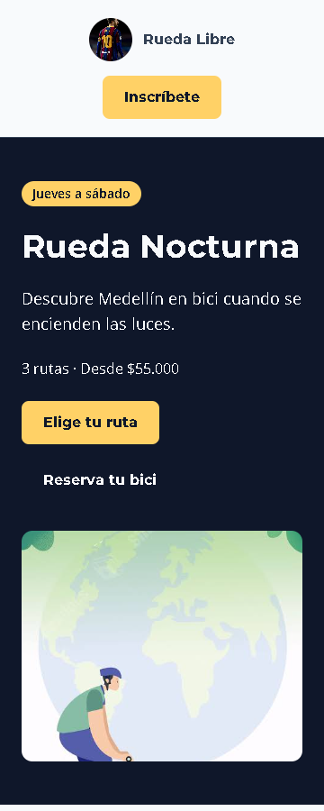
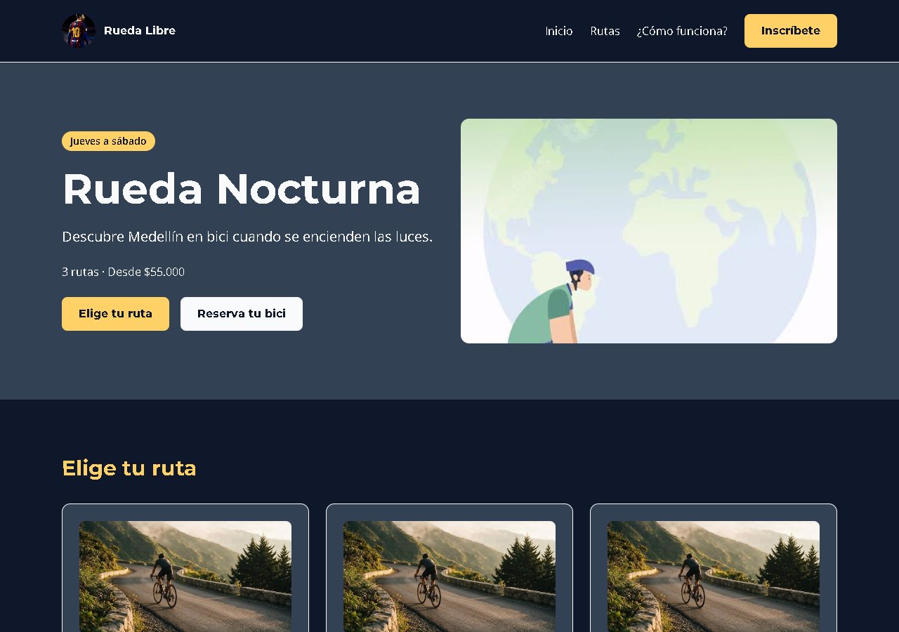

# Rueda Libre

Este proyecto es una pagina de alquiler de bicicletas en Medellín. Tambien tiene Rueda Nocturna, una campaña con rutas, planes y un formulario de inscripción.

## Enlaces

- [Sitio principal](https://andresfelipeorozcopaternina.github.io/rueda-libre/)
- [Rueda Nocturna](https://andresfelipeorozcopaternina.github.io/rueda-libre/nocturna/)
- [Formulario de inscripción](https://andresfelipeorozcopaternina.github.io/rueda-libre/nocturna/#inscripcion)

## Donde use cada framework

No cargue Bootstrap y Tailwind juntos en una misma pagina.

| Pagina | Framework | Donde lo use |
| --- | --- | --- |
| `index.html` | Bootstrap | Menu, carrusel, columnas de la portada, rutas, flota y beneficios |
| `paginas/tarifas.html` | Bootstrap | Menu y columnas para separar las tablas de la lista de que llevar. Las tablas conservan mi CSS |
| `paginas/reservas.html` | Bootstrap | Menu, columnas del formulario y contacto, y la fila de documento y celular. Los campos tienen CSS propio |
| `paginas/encuentranos.html` | Bootstrap | Menu de navegación. El resto conserva CSS propio |
| `pruebas/catalogo-bootstrap.html` | Bootstrap | Pruebas de las cards de bicicletas, columnas y beneficios |
| `nocturna/prototipo.html` | Tailwind con Play CDN | Primera prueba del titulo, fondo, textos y boton |
| `nocturna/componentes.html` | Tailwind | Botones, etiqueta, card y campo que reutilice en la landing |
| `nocturna/index.html` | Tailwind | Encabezado, rutas, pasos, planes, formulario, responsive y modo oscuro |

Tambien use HTML y CSS. Las fuentes son Montserrat y Open Sans. Los colores del sitio estan en `css/marca.css` y los de Tailwind en `nocturna/src/input.css`.

## Abrir en local

Abre la carpeta en VS Code y usa Live Server en `index.html`.
Para volver a generar el CSS de Tailwind necesitas Node y npm:

```sh
cd nocturna/src
npm ci
npm run build
```

`npm run dev` sirve para compilar mientras haces cambios. No se edita `output.css` a mano.

## Pruebas y pendientes

Se revisaron las paginas a 360, 768 y 1280 px, y la landing tambien a 1024 px. El formulario bloquea datos vacios o invalidos y se puede completar con teclado.
La landing y reservas quedaron sin errores en el W3C. Tambien se revisaron el contraste, el modo oscuro y los enlaces publicados.
El modo oscuro de la landing y el kit sigue el tema del sistema con dark: de Tailwind, sin JavaScript propio.
Los campos se validan con HTML. El envio esta deshabilitado hasta tener un servicio que reciba los datos.

## Bootstrap o Tailwind

Bootstrap me ayudo a empezar con las columnas y el carrusel. Con Tailwind tuve que aprender mas clases, pero fue mas facil organizar la landing y personalizarla.

Bootstrap carga 232.803 bytes de CSS y 80.721 de JavaScript del framework para el carrusel. La landing tiene 15.048 bytes de CSS compilado de Tailwind y no usa archivos JavaScript propios, imagenes y fuentes aparte. Bootstrap tambien usa mis hojas de CSS.
Para la siguiente version recomiendo Tailwind por el tamaño y la personalización, dejaria Bootstrap en las paginas que ya funcionan.

## Capturas

Escritorio


Celular



Modo oscuro



## Lo que aprendi

Grid me sirvio para cambiar las columnas segun el ancho. Flex me ayudo a dejar los botones de los planes a la misma altura. Tambien aprendi que validar un formulario no significa que ya se esten recibiendo los datos.

Los cambios y las pruebas estan en [bitacora.txt](bitacora.txt).

## Autor

Andrés Felipe Orozco Paternina - RIWI
