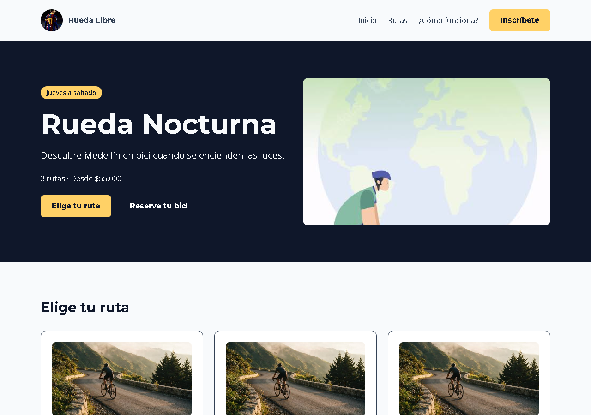
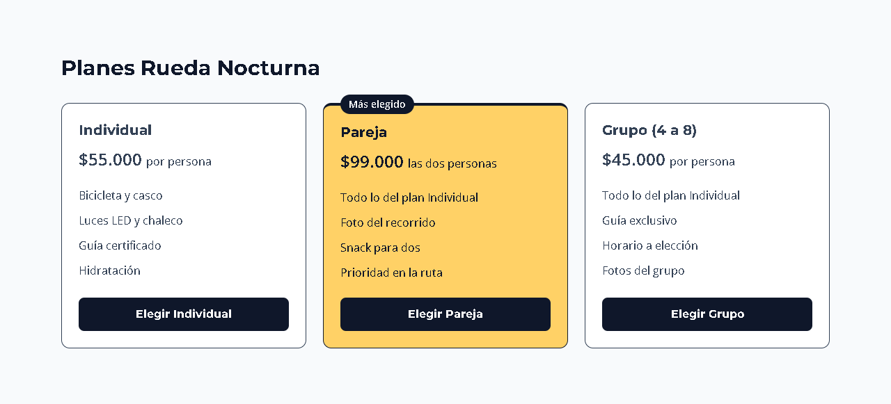

# Rueda Libre y Rueda Nocturna

Sitio de alquiler de bicicletas en Medellín y landing para los recorridos nocturnos. El sitio principal usa Bootstrap y la campaña usa Tailwind.

## Abrir el proyecto

- [Sitio Rueda Libre](https://andresfelipeorozcopaternina.github.io/rueda-libre/)
- [Rueda Nocturna](https://andresfelipeorozcopaternina.github.io/rueda-libre/nocturna/)
- [Inscripción](https://andresfelipeorozcopaternina.github.io/rueda-libre/nocturna/#inscripcion)
- [Kit de componentes](https://andresfelipeorozcopaternina.github.io/rueda-libre/nocturna/componentes.html)

El formulario valida los datos y está preparado para un servicio de recepción. **El envío real sigue pendiente de configurar**: el correo y el teléfono actuales son ejemplos. La página lo avisa y no muestra una confirmación falsa.

## Páginas

| Archivo | Contenido |
| --- | --- |
| `index.html` | Inicio, carrusel de cuatro diapositivas, rutas y flota |
| `paginas/tarifas.html` | Precios y recorridos |
| `paginas/reservas.html` | Formulario de reserva de bicicletas |
| `paginas/encuentranos.html` | Ubicación y contacto |
| `nocturna/index.html` | Campaña, rutas, pasos, planes e inscripción |
| `nocturna/componentes.html` | Botones, card, etiqueta y campo del kit |

## Tecnologías y uso local

HTML semántico, CSS, JavaScript sencillo, Bootstrap 5.3.3, Tailwind 4.3.4 y Google Fonts (Montserrat y Open Sans). Publicado con GitHub Pages.

Abre la carpeta con VS Code y usa Live Server sobre `index.html`. El CSS generado ya está incluido. Para reconstruirlo necesitas Node y npm:

```sh
cd nocturna/src
npm ci
npm run build
```

`npm run dev` recompila al guardar cambios. Edita `input.css`, no `output.css`. `css/marca.css` comparte los colores y las fuentes con las páginas de Bootstrap.

Para recibir inscripciones, coloca la URL real del servicio en `destino`, dentro de `nocturna/inscripcion.js`. Debe aceptar POST con FormData, permitir la conexión desde GitHub Pages y responder con un estado HTTP correcto. El mismo archivo también atiende el formulario de reservas. No agregues contraseñas ni claves privadas al repositorio.

## Pruebas y decisiones

- Responsive en 360, 768 y 1280 px. La landing también se revisó en 1024 px.
- Modo oscuro según la preferencia del sistema, sin botón ni librerías adicionales.
- Validación nativa de nombre, correo, celular, opciones obligatorias y acompañantes entre 0 y 3.
- Formulario completado con teclado y envío probado contra un receptor local simulado. Falta probar la recepción real cuando exista el destino.
- W3C Nu Validator: cero errores en la landing y en reservas.
- Revisión automática con axe: 24 comprobaciones de página, ancho y tema, sin incidencias detectadas de WCAG A/AA ni scroll horizontal. Se complementó con el recorrido del formulario por teclado.
- Medidas de los planes a 1280 px: 352 px de ancho, 353 px de alto y 24 px de relleno; botones alineados.
- Los tiempos y los resultados completos están en [bitacora.txt](bitacora.txt).

## Bootstrap o Tailwind

| Criterio | Bootstrap | Tailwind |
| --- | --- | --- |
| Aprendizaje | Las columnas y los componentes permiten empezar rápido | Hay que aprender utilidades y prefijos |
| Personalización | Necesité CSS propio para la marca | El tema y sus utilidades permiten usarla directamente |
| Tamaño medido | CSS: 232.803 bytes; bundle JS: 80.721 bytes | CSS final: 14.878 bytes; JS propio: 1.278 bytes |
| Uso | Tablas, formularios y carrusel del sitio | Layout, planes y modo oscuro de la campaña |

Son tamaños sin comprimir, sin imágenes ni fuentes. En Bootstrap tampoco incluyen el CSS propio. En el reto 8 Tailwind pesaba 13.856 bytes; después se agregaron el formulario y los planes.

Recomiendo Tailwind para la próxima versión por la personalización y el tamaño. Mantendría Bootstrap en las páginas actuales hasta que sea necesario cambiarlas.

## Capturas

### Escritorio



### Celular


### Modo oscuro


### Planes



## Mapa de los 12 MiniRetos

| Reto | Aporte al producto |
| --- | --- |
| 1 | Prototipo de la sección principal con Play CDN |
| 2 | Compilación con CLI y botones |
| 3 | Cards de las tres rutas |
| 4 | Kit de componentes reutilizables |
| 5 | Estructura de la landing |
| 6 | Distribución mobile-first |
| 7 | Tema, fuentes y modo oscuro |
| 8 | Botones reutilizados y comparación de frameworks |
| 9 | Inscripción con validaciones |
| 10 | Menús, carrusel e identidad compartida |
| 11 | Planes Individual, Pareja y Grupo |
| 12 | Revisión final, documentación, publicación y guion de demo |

## Aprendizajes y demo

Grid facilita cambiar las columnas por tamaño de pantalla. Flex permite dejar los botones al final de las cards. Las validaciones nativas ahorran código y el contraste se debe medir también en oscuro.

El [guion de demo](docs/demo.md) organiza un recorrido de menos de tres minutos. El ensayo con un compañero y su retroalimentación quedan pendientes; no se registró una opinión inventada.

En la rama [andres_pruebas](https://github.com/AndresFelipeOrozcoPaternina/rueda-libre/tree/andres_pruebas) están las explicaciones línea por línea para estudiar.

## Autor

Andrés Felipe Orozco Paternina — proyecto de formación RIWI.
